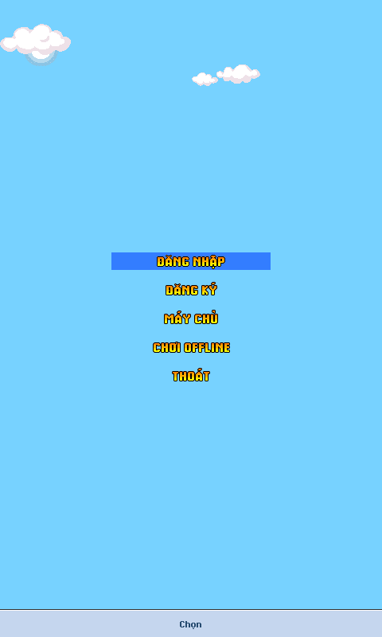
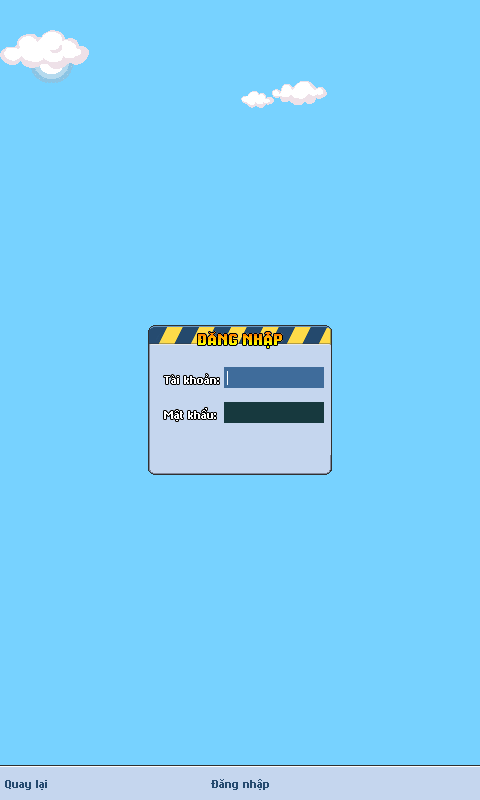
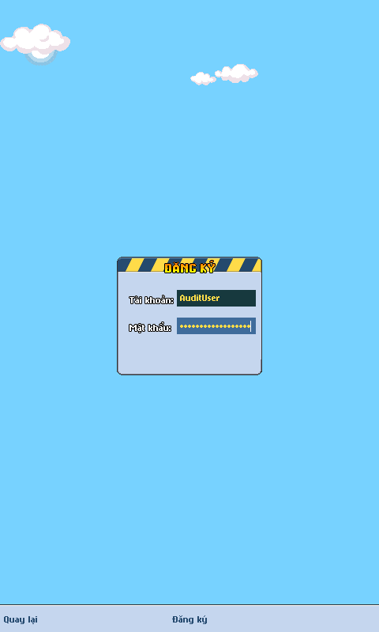
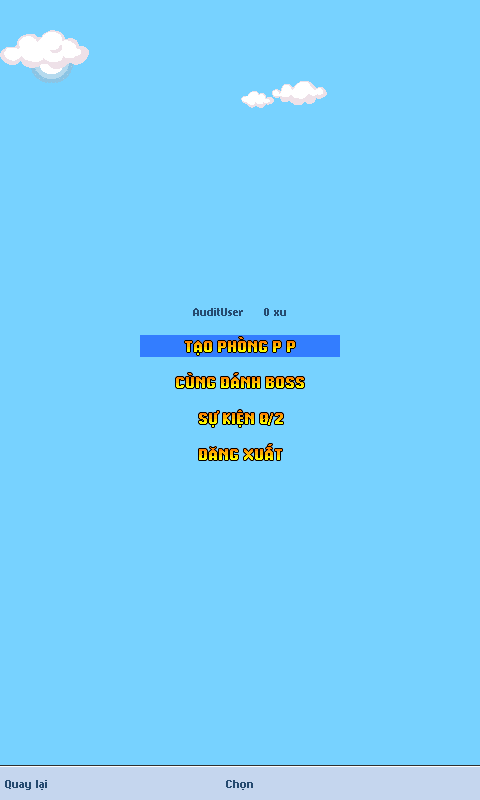
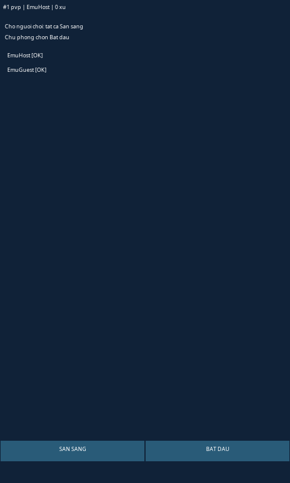
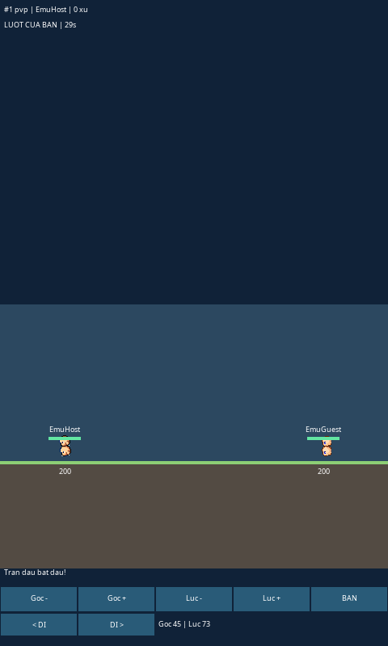
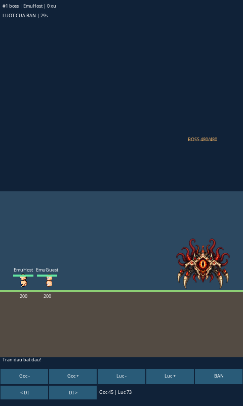

# Kết quả kiểm thử từng màn hình — ARMY2 Online v0.1

Đây là ảnh và kết quả lịch sử trước khi đổi đồ họa sân thử nghiệm sang map băng. Xem [báo cáo kiểm thử gần nhất](kiem-thu-chi-tiet/BAO_CAO.vi.md) để biết giao diện và phạm vi hiện tại.

Các ảnh bên dưới được chụp từ JAR build trong MicroEmulator bằng **tài khoản thử nghiệm** và server local có database tạm. Đây là giả lập Java ME, chưa phải Manic EMU trên iPhone. Không dùng tài khoản thật hay database đang vận hành của bạn.

## Màn hình chính

| Nút | Chuyển đến / hành động | Kết quả |
|---|---|---|
| ĐĂNG NHẬP | Màn hình nhập tài khoản; nếu đã có phiên hợp lệ, vào sảnh | Đã thử mở màn hình và đăng nhập thành công |
| ĐĂNG KÝ | Màn hình tạo tài khoản online | Đã thử chạm, nhập và tạo thành công |
| MÁY CHỦ | Màn hình nhập địa chỉ server | Đã thử lưu địa chỉ, từ chối HTTP từ xa và địa chỉ giả localhost |
| CHƠI OFFLINE | Menu gốc của JAR | Đã thử mở menu, chưa chơi hết các tính năng offline |
| THOÁT | Dừng ứng dụng | Đã thử trong tiến trình giả lập riêng |

## Đăng nhập, đăng ký và địa chỉ server

| Nút hoặc thao tác | Chuyển đến / hành động | Kết quả |
|---|---|---|
| Chạm ô Tài khoản / Mật khẩu | Mở ô nhập của trình giả lập; OK lưu nội dung vừa nhập, Hủy giữ giá trị cũ | Đã thử cả OK và Hủy; mật khẩu được che trên màn hình |
| Đăng ký | Gửi thông tin đến server; thành công vào sảnh | Đã thử thành công; tên trùng, tên ngắn và mật khẩu ngắn bị từ chối |
| Đăng nhập | Kiểm tra tài khoản trên server; thành công vào sảnh | Đã thử đúng và sai mật khẩu |
| Quay lại | Về màn hình chính | Đã thử trên cả đăng nhập và đăng ký |
| MÁY CHỦ → Lưu | Lưu địa chỉ server và về màn hình chính | Đã thử. Đổi server xóa phiên online hiện tại |

Ảnh thông báo: [để trống](screenshots/05-empty.png), [tên không hợp lệ](screenshots/06a-invalid-name.png), [mật khẩu ngắn](screenshots/06b-short-password.png), [sai mật khẩu](screenshots/10-wrong-password.png), [tên đã tồn tại](screenshots/12-duplicate-account.png), [HTTP từ xa bị từ chối](screenshots/03-server-invalid.png).

## Sảnh online

| Nút | Chuyển đến / hành động | Kết quả |
|---|---|---|
| TẠO PHÒNG PvP | Tạo phòng 1v1, mở màn hình chờ | Đã thử với hai giả lập |
| CÙNG ĐÁNH BOSS | Tạo phòng boss, mở màn hình chờ | Đã thử với hai giả lập |
| SỰ KIỆN | Nhận 200 xu nếu thắng boss đủ 2 lần trong ngày và chưa nhận | Đã thử nút khi chưa đủ điều kiện; hai trận boss và nhận một lần được thử ở backend |
| ĐĂNG XUẤT | Thu hồi phiên đó trên server, xóa phiên tại client và về menu chính | Đã thử; phiên cũ bị server từ chối |
| Phòng trong danh sách | Vào phòng tương ứng | Đã thử bằng tài khoản thứ hai |
| Quay lại | Về menu chính, giữ phiên để có thể vào lại | Có trong mã; chưa có bài kiểm thử riêng cho trạng thái giữ phiên |

## Phòng và trận

| Nút | Hành động | Kết quả |
|---|---|---|
| SẴN SÀNG | Đổi trạng thái sẵn sàng | Đã thử bật ở hai client; chưa thử riêng thao tác tắt lại trên giao diện |
| BẮT ĐẦU | Chủ phòng bắt đầu khi đủ người và đã sẵn sàng | Đã thử thành công và thử khi thiếu người; [ảnh thông báo](screenshots/15-room-error.png) |
| Góc − / Góc + | Điều chỉnh góc bắn | Đã thử trên màn hình trận PvP |
| Lực − / Lực + | Điều chỉnh lực bắn | Đã thử trên màn hình trận PvP |
| BẮN | Gửi lệnh bắn; server tính đường đạn, sát thương và đồng bộ HP | Đã thử đến hết trận PvP và boss |
| ĐI trái / ĐI phải | Di chuyển trong lượt | Đã thử ĐI phải trên màn hình; giới hạn di chuyển đã thử ở backend. ĐI trái trên giao diện chưa được kiểm tra riêng |
| Bỏ lượt | Chuyển lượt | Đã thử qua lệnh của màn hình trận PvP |
| Rời phòng | Về sảnh | Đã thử sau trận; bỏ cuộc giữa trận được thử ở backend |

## Kiểm thử đăng nhập và nơi lưu

- Bộ kiểm thử backend: 21 trường hợp đã chạy thành công, bao gồm tên 3–16 ký tự, ký tự không hợp lệ, phân biệt tên trùng không kể hoa/thường, mật khẩu 10–128 ký tự, tên không tồn tại, sai mật khẩu, giới hạn số lần đăng nhập, phiên giả/hết hạn, đăng xuất và khởi động lại server.
- Khi server thực tế được triển khai theo cấu hình EC2 đi kèm, dữ liệu SQLite nằm tại **`/var/lib/army2-online/army2.sqlite3` trên EC2**. Khi chạy local theo hướng dẫn, đường dẫn mặc định là `online/data/army2.sqlite3` trên máy chạy server. Bài kiểm thử ở đây dùng database tạm và tự xóa sau khi chạy.
- Server lưu tên tài khoản, salt ngẫu nhiên và **giá trị băm PBKDF2-HMAC-SHA256 200.000 vòng**; không lưu mật khẩu gốc trong bảng tài khoản. Server lưu **bản băm SHA-256 của token phiên**, thời hạn 7 ngày; đăng xuất thu hồi token đang dùng.
- Trên thiết bị, JAR lưu địa chỉ server và token phiên trong **RMS** của trình giả lập, không lưu mật khẩu vào RMS của tính năng online mới. Token được lưu để đăng nhập lại; mức bảo vệ file RMS phụ thuộc ứng dụng giả lập và thiết bị.
- Có giao diện đăng ký/đăng nhập của game cloud cũ trong chế độ offline. Đó là hệ thống riêng; kiểm thử này không xác nhận hoặc thay đổi nơi lưu tài khoản cloud cũ.
- Không có đặt lại mật khẩu hoặc công cụ quản trị tài khoản trong bản thử nghiệm. Khi chạy sau nginx, giới hạn 20 lần đăng nhập/đăng ký mỗi phút hiện áp dụng theo địa chỉ mà backend nhìn thấy; cần kiểm tra cấu hình proxy trước khi nhiều người dùng chung server.

## Phạm vi và giới hạn

Hai JAR gốc có hàng nghìn class và nhiều màn hình offline; báo cáo này bao phủ **phần online mới**, cộng kiểm tra mở menu offline gốc, không khẳng định đã kiểm thử toàn bộ các chức năng của hai JAR. Chưa có EC2, HTTPS công khai hay iPhone/Manic EMU thật trong lần kiểm thử này. Chưa kiểm thử tải đông người, ứng dụng khi mất mạng kéo dài trên iOS, đặt lại mật khẩu, hoặc phục hồi sau mất dữ liệu EC2.

Lệnh chạy lại: `python3 -m unittest discover -s tests -v`, `python3 tools/audit_screens.py`, `python3 tools/test_emulator.py` từ thư mục `online`. Ảnh lưu ở `test-results` và bản sao tại đây dùng tài khoản thử nghiệm.
