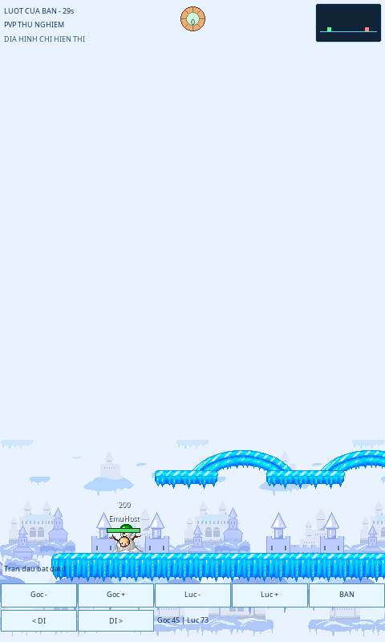

# Đồ họa trận và báo cáo kiểm thử chi tiết

JAR thử nghiệm: `ARMY2_Online_IOS.jar`; SHA-256 `25f4eda55a0dcbc8dd38dbca47e08ef17c9f96ee1225310eaa57606da45a9eea`. Tất cả tài khoản, dữ liệu và server sử dụng để kiểm thử đều là tạm thời. Mã, JAR và tài liệu được lưu trên nhánh `feat/original-character-sync`.

**Chưa hoàn tất chuyển gameplay gốc sang multiplayer.** Trận PvP/boss bên dưới là chế độ online thử nghiệm. Việc dùng hình ảnh gốc không chứng minh các map, vật phẩm, đạn hay boss gốc đã được chuyển logic sang server.

## Thay đổi hình ảnh

Trận thử nghiệm giờ đọc trực tiếp map `0_caycaubang.map` (800×600, 52 khối), ảnh các khối băng, nền và sprite từ `IOS_TuTien.jar`. Phòng chờ, thanh thông tin, bản đồ nhỏ và nút điều khiển cũng được vẽ lại. Chạm vào vị trí trên bản đồ nhỏ ở góc phải để quan sát vị trí đó; khi đạn đang bay, camera đi theo đường đạn. Những thay đổi này không sửa 1.192 class gốc.



[Ảnh nhìn đối thủ qua camera](anh-chinh/02-camera-doi-thu.png) · [Ảnh nhìn boss](anh-chinh/04-camera-boss.png) · [Ảnh cỡ 240×320](anh-chinh/05-pvp-man-nho.png) · [Ảnh trận bot gốc để đối chiếu](anh-chinh/06-bot-goc.png).

**Giới hạn quan trọng:** những cầu, khối băng phía trên là đồ họa. Server thử nghiệm hiện vẫn tính vật lý theo sàn phẳng; chúng chưa cản đạn hay bị phá như trong game gốc. Màn trận hiện ghi `DIA HINH CHI HIEN THI` để người chơi biết điều đó. Giao diện chỉ dùng một map băng cho chế độ thử nghiệm, chưa phải danh sách map online gốc.

## Kết quả trận

| Tình huống | Cách thử | Quan sát |
|---|---|---|
| Hai người PvP thử nghiệm | Hai JVM kết nối cùng server; chủ phòng tạo, khách vào, cả hai sẵn sàng và bắt đầu. Mỗi người thực hiện một lần di chuyển và một phát bắn trúng. | Chủ phòng sang phải từ x=120 đến 150; khách sang trái từ x=600 đến 570. Cả hai máy đều thấy HP của cả hai giảm từ 200 xuống 115 và cùng trạng thái lượt `seq=5`. Trước lượt mình, thao tác di chuyển/bắn của khách không thay đổi trạng thái. |
| Camera PvP | Cả hai phiên chạm bản đồ nhỏ để xem vị trí phía đối thủ. | Góc nhìn chuyển; có ảnh ở trên. Đã chạy cả 480×800 và 240×320. |
| Boss thử nghiệm | Hai JVM vào cùng phòng, bắn tới khi kết thúc; thử camera đến vị trí boss. Đường HTTPS dùng CA thử nghiệm tin cậy trong máy. | Hai người thấy thắng và mỗi người nhận 100 xu thử nghiệm. Chưa phải boss gốc. |
| Bot gốc offline | Tạo nhân vật thử, vào cấu hình bot và trận mặc định; mô phỏng giữ phím đi phải. Dùng phép tính đường đạn của JAR để chọn góc/lực, rồi gọi hàm bắn gốc. | Lần chạy trên JAR cuối ghi x=200→231, HP bot 1.030→736. Bot nhận lượt và bắn trả; HP người chơi giảm 1.000→550. Đây là một kịch bản với một bot. |

Ảnh [sau trao đổi hai lượt](anh-chinh/03-sau-hai-luot-ban.png) và [lượt bot](anh-chinh/07-bot-ban-tra.png). Bài bot thao tác bằng công cụ giả lập và gọi một số hàm gốc trực tiếp; không chứng minh nút cảm ứng iPhone đã hoạt động.

## Các màn hình và nút

[**Xem luồng mở JAR, đăng ký, phòng và trận thử nghiệm**](LUONG_ONLINE.vi.md), kèm ảnh ở từng bước.

[**Mở danh sách 252 đường đi hoặc thao tác, kết quả và ảnh chụp**](DANH_SACH_MAN_HINH.vi.md). Danh sách ghi rõ màn nào hiện ra, hộp thoại hoặc menu nào xuất hiện, và lỗi bắt được. Bản ghi máy đọc nằm ở [ket_qua_chi_tiet.json](ket_qua_chi_tiet.json).

[**Xem kết quả và ảnh 29 map PvP bot gốc**](DANH_SACH_MAP_BOT.vi.md). Cả 29 map đã vào được màn trận và tải đủ ảnh khối trong kịch bản nhân vật mới, một bot, độ khó mặc định; đây chưa phải kiểm thử hoàn thành trận hay mọi vũ khí trên mỗi map.

[**Xem 15 cửa boss gốc**](DANH_SACH_BOSS_GOC.vi.md). Trong kịch bản nhân vật mới và chọn mức 1, 14 cửa vào được màn trận; cửa Boss Thế Giới báo chưa đến giờ. Chưa kiểm thử đánh thắng và phần thưởng của từng boss.

Các nhánh đã quan sát gồm màn hình chính, đăng ký/đăng nhập, máy chủ, sảnh, phòng, nhân vật, boss, bot, nhiệm vụ, chọn nhân vật, đội hình, cửa hàng, nâng cấp, trang bị, tu tiên, item, túi boss, thức tỉnh, săn boss và giftcode. Nhiều thao tác được thử bằng cách chọn mục qua công cụ kiểm thử và gọi action gốc trong JVM độc lập; kết quả chỉ xác nhận trạng thái nhìn thấy ngay sau thao tác, không đảm bảo nghiệp vụ phía sau hoàn tất.

## Vấn đề và phạm vi chưa kiểm chứng

- **CLOUD SAVE cũ:** MicroEmulator gặp `VerifyError` trong `GDriveAccounts2328.cloudCaptureStatus`. Không suy ra Manic EMU cũng gặp lỗi này khi chưa thử trên iPhone.
- **Nâng cao gốc:** trong nhân vật mới, game báo tài khoản chưa kích hoạt Cloud hoặc sai tên nhân vật. Chức năng này chưa được nối vào tài khoản server mới.
- **MULTIPLAYER trong menu gốc:** báo không kết nối được server multiplayer cũ; không phải hai phòng thử nghiệm mới.
- **Rương đồ gốc:** ở nhánh `Bắt đầu → Trang bị → Menu → Rương đồ`, một phiên MicroEmulator ghi `NullPointerException` trong `Inventory.paint`/`Font.drawStringBase120` trong khi vẽ. Ba lần thử lại độc lập không ghi lại lỗi đó; có thể lỗi phụ thuộc thời điểm. [Xem trích log](loi-ruong.txt). Chưa xác nhận trên Manic EMU.
- **Chọn map bot:** một kịch bản khởi tạo thử làm 29 ID map lặp thành 145 mục, cộng mục ngẫu nhiên. Chưa xác minh mọi thao tác người chơi thông thường đều gặp lỗi này.
- Không tuyên bố đã kiểm thử hết mọi trạng thái, vật phẩm, vũ khí, nhân vật, map, boss, nâng cấp, điều kiện sự kiện, lỗi mạng hoặc khả năng lưu trên Manic EMU. Chưa có phiên multiplayer dùng engine gốc để thử. Chưa triển khai hay đo tải EC2.

## Môi trường và cách chạy lại

MicroEmulator 2.0.4 trên Linux, hai JVM độc lập và server Python/SQLite local; 25 kiểm thử backend đã qua. Đây không phải kiểm thử trên iPhone. Các lệnh:

```bash
cd online
python3 tools/build_client.py
python3 -m unittest discover -s tests -v
python3 tools/test_emulator.py duel boss
ARMY_TEST_WIDTH=240 ARMY_TEST_HEIGHT=320 python3 tools/test_emulator.py duel
python3 tools/audit_screens.py
python3 tools/test_profiles_emulator.py
python3 tools/audit_bot.py
python3 tools/audit_bot_maps.py
python3 tools/report_bot_maps.py
python3 tools/audit_boss_entries.py
python3 tools/report_boss_entries.py
python3 tools/audit_game_navigation.py
python3 tools/audit_game_navigation.py --frontier
python3 tools/report_navigation.py
```

Bộ menu cơ bản được ghi bằng JAR có SHA `b4391716af945f22ffdfe0d0f62544740d29b8ed92311a5b69555110fb0798c710`; so sánh từng entry ZIP với JAR cuối cho thấy chỉ `army2/online/Arena.class` đổi để bổ sung dòng cảnh báo địa hình và hoạt ảnh. Các menu gốc và các class/tài nguyên khác giữ nguyên. Một phần menu sâu được chạy trên JAR ngay trước thay đổi hoạt ảnh; các ảnh trận, bot và cửa boss được chạy trên JAR cuối.
