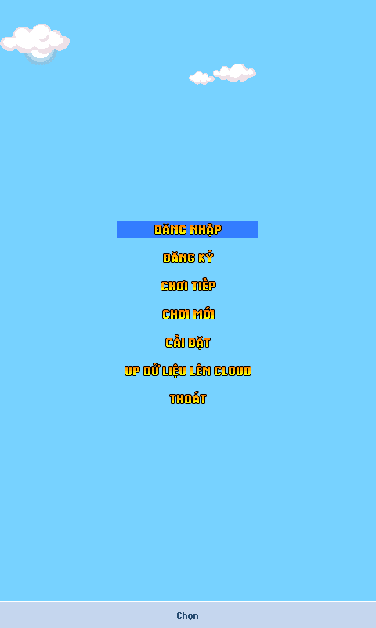
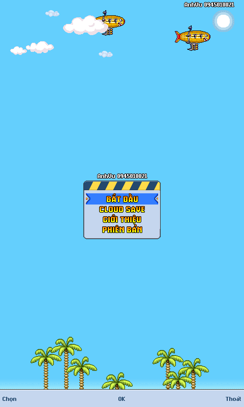

# Kiểm thử JAR gốc IOS_TuTien (1).jar

## Phạm vi

File được gửi có SHA-256 `27c94dc245cb70fe9514f9906a0a57209e63aaca2e670027b23037a606b95cc4`, trùng từng byte với `IOS_TuTien.jar` đã có trong repo. Manifest ghi phiên bản MIDlet **2.3.23**; file có 1.192 class. Đây là JAR gốc, khác với `ARMY2_Online_IOS.jar` đã phát triển thêm.

Lần kiểm thử dùng **MicroEmulator 2.0.4**, Java 21, màn hình 480×800 và RMS **trong bộ nhớ tạm**. Test kích hoạt các handler/command của chính JAR bằng mã tự động và chụp màn hình thật của giả lập. Các thao tác chọn một số giá trị được mô phỏng qua API của game; đây không phải kiểm thử chạm trên iPhone. Nhân vật `TestHero` chỉ tồn tại trong bộ nhớ giả lập và đã bị xóa khi tiến trình kết thúc.

## Những màn hình đã kiểm tra

| Nút / bước | Kết quả quan sát được |
|---|---|
| ĐĂNG NHẬP | **Không đạt trên MicroEmulator:** khi chọn, JVM báo `VerifyError` trong class `GDriveAccounts2328`, phương thức `cloudCaptureStatus`. Không tới được màn nhập tài khoản. |
| ĐĂNG KÝ | **Không đạt trên MicroEmulator:** gặp cùng `VerifyError` khi mở chức năng. Không thể kiểm thử đăng ký thành công, tên trùng hoặc mật khẩu sai. |
| CHƠI TIẾP, khi không có save | Game hiển thị thông báo không tải được; chi tiết cũng chứa `VerifyError`. [Ảnh thông báo](07-continue-error.png). Chưa kiểm thử Chơi tiếp sau khi đóng/mở lại app. |
| CÀI ĐẶT | Mở [màn hình cài đặt](06-settings.png); chọn tốc độ và Lưu, quay về menu. Đã đọc lại lựa chọn trong RMS tạm và giá trị trùng. Âm thanh chưa được xác minh do giả lập headless không có thiết bị âm thanh/codec tương ứng. |
| CHƠI MỚI | Hiện [xác nhận](08-newgame-confirm.png); đã thử Hủy, sau đó chọn Đồng ý và [nhập tên](09-new-character-name.png). Tạo `TestHero` thành công trong RMS tạm. |
| UP DỮ LIỆU LÊN CLOUD | Chưa kiểm thử riêng. Mã liên quan đến class cloud đang gặp lỗi trên giả lập; không suy ra kết quả thực tế khi bấm. |
| THOÁT | Chưa kiểm thử riêng trên bản gốc. |

Sau khi tạo nhân vật thử, `OfflineSave.hasSave()` trả về đúng; test đổi tạm tên trong RAM rồi gọi `OfflineSave.load()` và nhận lại tên `TestHero`. Đây là kiểm tra **lưu/đọc trong cùng phiên giả lập**, chưa chứng minh dữ liệu tồn tại sau khi khởi động lại app hoặc trên Manic EMU.

## Luồng boss offline

| Bước | Kết quả |
|---|---|
| BẮT ĐẦU | Mở [menu con](11-start-submenu.png) |
| CHƠI NGAY | Mở [danh sách chế độ](12-battle-modes.png), gồm boss, PvP bot, multiplayer và mục khác |
| ĐẤU BOSS | Mở [danh sách phòng boss](13-boss-list.png) |
| Chọn phòng đầu tiên | Hiện [hộp chọn độ khó](14-boss-enter.png); nhập `1` mở [màn chuẩn bị](15-boss-ready.png) |
| BẮT ĐẦU trong phòng | Mở `GameScr` và [màn trận](16-boss-battle.png) |

Chưa thực hiện bắn, hoàn thành trận, nhận thưởng hay kiểm tra lưu sau trận. Chưa kiểm thử tất cả boss, vật phẩm, sự kiện hoặc các nhánh menu còn lại.

## Đăng ký, đăng nhập và lưu thông tin

Phân tích bytecode cho thấy luồng cloud trong bản này yêu cầu tên tài khoản khớp tên nhân vật cục bộ; mã có bước nhập mật khẩu và thông báo tài khoản đăng ký chờ admin duyệt. Vì class cloud bị JVM từ chối ngay khi mở, **các điều kiện này là kết quả đọc mã, chưa được xác nhận qua đăng nhập thành công**.

- File save offline dùng Java ME RMS, khóa `offlineSave_v2`; có các khóa sao lưu/journal. Trình giả lập quyết định vị trí vật lý của RMS trên thiết bị.
- Luồng cloud có lưu tên và token phiên trong RMS (`anhvu_v2_user_2328`, `anhvu_v2_session_2328`). Không thấy bước lưu mật khẩu gốc vào RMS trong luồng này qua phân tích mã.
- JAR gọi một API cloud bên ngoài. Repo chỉ có client, không có mã backend hoặc database của dịch vụ đó. **Không thể xác định** tài khoản/mật khẩu ở server được lưu ở đâu hay được băm như thế nào.
- **Rủi ro cụ thể:** mã chuẩn bị JSON có trường `password` và gửi POST tới địa chỉ `http://api.army2tutien.io.vn/api` bằng HTTP. HTTP không bảo vệ nội dung trên đường truyền như HTTPS. Chưa kiểm tra được server có redirect hay tầng bảo vệ khác; không nên dùng mật khẩu quan trọng hoặc mật khẩu dùng chung với tài khoản khác cho bản này.

## Hai giới hạn cần phân biệt

1. MicroEmulator/JVM báo `VerifyError: Illegal target of jump or branch` ở `GDriveAccounts2328.cloudCaptureStatus`. JAR không bị lỗi ZIP; đây là lỗi khi JVM xác minh bytecode của class. Manic EMU có thể xử lý khác, vì vậy chưa thể khẳng định kết quả trên iPhone nếu chưa thử trực tiếp.
2. Yêu cầu GET thử tới API cloud trả **403 `Domain forbidden` từ proxy của môi trường kiểm thử**. Điều này cho biết môi trường không được phép tới domain đó; **không chứng minh server cloud đang hoạt động hay ngừng hoạt động**. Không gửi tài khoản/mật khẩu thật và không tạo tài khoản ở dịch vụ bên ngoài trong lần kiểm thử này.

Không thể gọi đăng ký/đăng nhập của bản gốc là đã hoạt động: cần kiểm tra trên đúng Manic EMU, đồng thời có dịch vụ cloud tương thích và tài khoản thử được cấp. Lần kiểm thử không chỉnh sửa JAR gốc.

Chạy lại trong môi trường repo: `cd online && python3 tools/audit_original_jar.py ../IOS_TuTien.jar`. Công cụ tạo thư mục kết quả mới dưới `test-results/original-jar`, bao gồm ảnh và log. Dòng `Audit completed WITH failures` là kết quả có lỗi được phát hiện, không phải thông báo pass toàn bộ.
